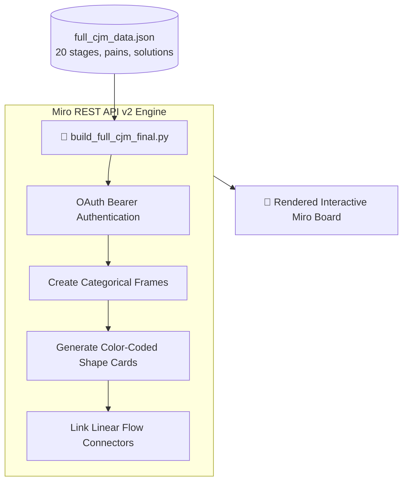

<div align="center">

# 🏦 Banking Process Modeling & Automated CJM via Miro API

**Comprehensive Business Analysis showcase: automated Customer Journey Map (CJM) generation across 20 user stages via Miro REST API v2, BPMN 2.0 AS-IS / TO-BE process modeling in Draw.io, and Business Requirements Documents (BRD).**

[](https://www.python.org/)
[](https://developers.miro.com/)
[](https://www.bpmn.org/)
[](https://app.diagrams.net/)
[](LICENSE)

[🇷🇺 Читать на русском](README.md) • [🇬🇧 Read in English](README.en.md)

---

</div>

## 📑 Table of Contents

1. [Business Context & Problem Statement](#1-business-context--problem-statement)
   * [1.1. Omnichannel Banking Challenges](#11-omnichannel-banking-challenges)
   * [1.2. Project Goals](#12-project-goals)
2. [Key Business Analysis Deliverables](#2-key-business-analysis-deliverables)
   * [2.1. Programmatic CJM Board Generation in Miro](#21-programmatic-cjm-board-generation-in-miro)
   * [2.2. BPMN 2.0 AS-IS & TO-BE Workflows (ATMs & Teller Desks)](#22-bpmn-20-as-is--to-be-workflows-atms--teller-desks)
   * [2.3. Business Requirements Documents (BRD)](#23-business-requirements-documents-brd)
3. [Miro REST API v2 Automation Architecture](#3-miro-rest-api-v2-automation-architecture)
   * [3.1. Integration Flowchart](#31-integration-flowchart)
   * [3.2. Project Hierarchy](#32-project-hierarchy)
4. [Technology Stack](#4-technology-stack)
5. [Installation & Execution](#5-installation--execution)
6. [Author & Contacts](#6-author--contacts)

---

## 1. Business Context & Problem Statement

### 1.1. Omnichannel Banking Challenges
In modern retail and corporate banking environments (physical branches, cash desk operations, self-service ATMs, and mobile apps), journey friction frequently degrades conversion. Manually sketching complex multi-lane Customer Journey Maps and aligning cross-departmental requirements across business stakeholders and IT takes weeks.

### 1.2. Project Goals
* **Automate & Digitize:** Transform UX research datasets into structured JSON models and programmatically compile interactive visual boards in Miro via API;
* **Streamline Operations:** Architect transparent AS-IS models highlighting current operational bottlenecks alongside optimized TO-BE targets in BPMN 2.0;
* **Engineer Delivery Artifacts:** Standardize Business Requirements Documents (BRD) ready for agile IT sprint backlogs.

---

## 2. Key Business Analysis Deliverables

### 2.1. Programmatic CJM Board Generation in Miro
The `build_full_cjm_final.py` client reads `full_cjm_data.json` and programmatically renders 20 stages of the omnichannel journey on Miro:
* **Scope:** Spans from passive street attention to foreign exchange cash desk operations, ATM cash withdrawals, and onboarding onto the mobile banking app.
* **Information Architecture per Stage:**
  1. *Touchpoint* (Physical / Digital channel);
  2. *User Objective / Job-to-be-Done*;
  3. *Emotional Valence & Importance Index* (Scale 1–5);
  4. *Customer Barriers & Pain Points*;
  5. *Actionable Product Solutions & Feature Hypotheses*.

### 2.2. BPMN 2.0 AS-IS & TO-BE Workflows (ATMs & Teller Desks)
Vector diagram files stored in `diagrams/`:
* `asis в банкоматах.drawio` vs `to be в банкоматах.drawio` — eliminates redundant confirmation dialogs, minimizes cash dispensing cycle latency.
* `asis в кассах.drawio` vs `to be в кассах.drawio` — integrates digital queue routing and automated FX exchange rates without manual operator overhead.

### 2.3. Business Requirements Documents (BRD)
Production specifications in `specs/`:
* `BRD-AFXRatesByRanges-Radius.md` — specifications for FX tiered rate logic migration into the Radius platform.
* `01_шаблон_банкоматы.md`, `02_эталон_кассы.md` — functional, non-functional, and acceptance criteria.

---

## 3. Miro REST API v2 Automation Architecture

### 3.1. Integration Flowchart



### 3.2. Project Hierarchy

```text
07-alfabank-cjm-process-map/
├── build_full_cjm_final.py       # Python Miro REST API v2 client
├── full_cjm_data.json            # Structured dataset of 20 customer journey stages
├── build_bpmn.py                 # Procedural BPMN element builder
├── diagrams/                     # Draw.io vector process diagrams
│   ├── asis в банкоматах.drawio
│   ├── to be в банкоматах.drawio
│   ├── asis в кассах.drawio
│   └── to be в кассах.drawio
├── specs/                        # Business Requirements Documents (BRD)
│   ├── BRD-AFXRatesByRanges-Radius.md
│   ├── 01_шаблон_банкоматы.md
│   └── 02_эталон_кассы.md
├── requirements.txt              # Python dependencies
├── .env.example                  # Environment variable template
├── .gitignore                    # Version control exclusions
├── README.md                     # Russian documentation
└── README.en.md                  # English documentation
```

---

## 4. Technology Stack

* `Python 3.10+` & `Requests`
* `Miro REST API v2` (Shapes, Frames, Connectors)
* `BPMN 2.0` (Business Process Model and Notation)
* `Draw.io XML`
* `Business Requirements Document (BRD) Framework`

---

## 5. Installation & Execution

```bash
git clone https://github.com/Andrew123485/alfabank-cjm-process-map.git
cd alfabank-cjm-process-map

python -m venv venv
.\venv\Scripts\activate
pip install -r requirements.txt

# Configure Miro credentials
cp .env.example .env
# Set MIRO_TOKEN and MIRO_BOARD_ID in .env

# Run board compilation
python build_full_cjm_final.py
```

---

## 6. Author & Contacts

* **Author:** Andrei Vladimirov
* **Specialization:** Business Analyst / Product Manager (Fintech / CIB)
* **Telegram:** [@amorfatimementomoria](https://t.me/amorfatimementomoria)
* **GitHub:** [github.com/Andrew123485](https://github.com/Andrew123485)
