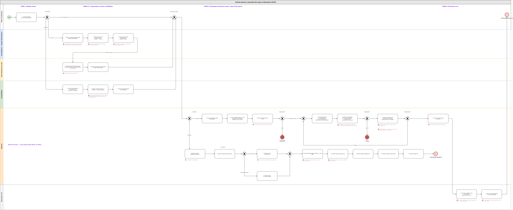
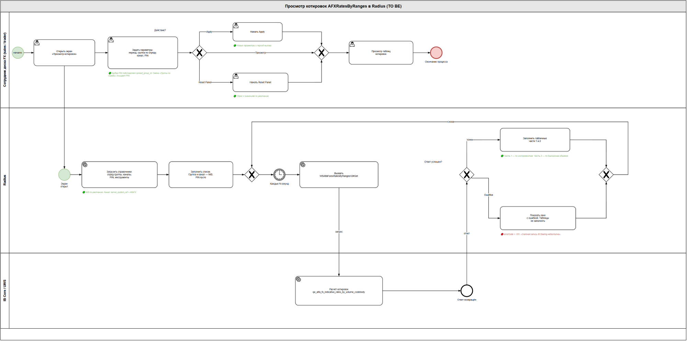
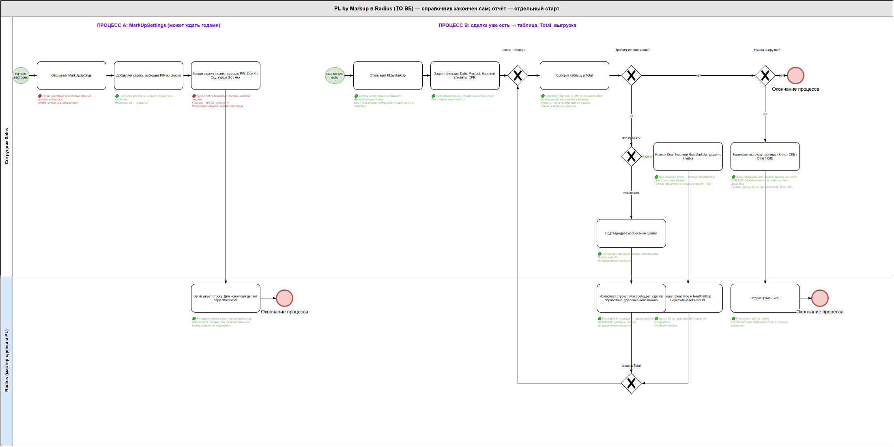
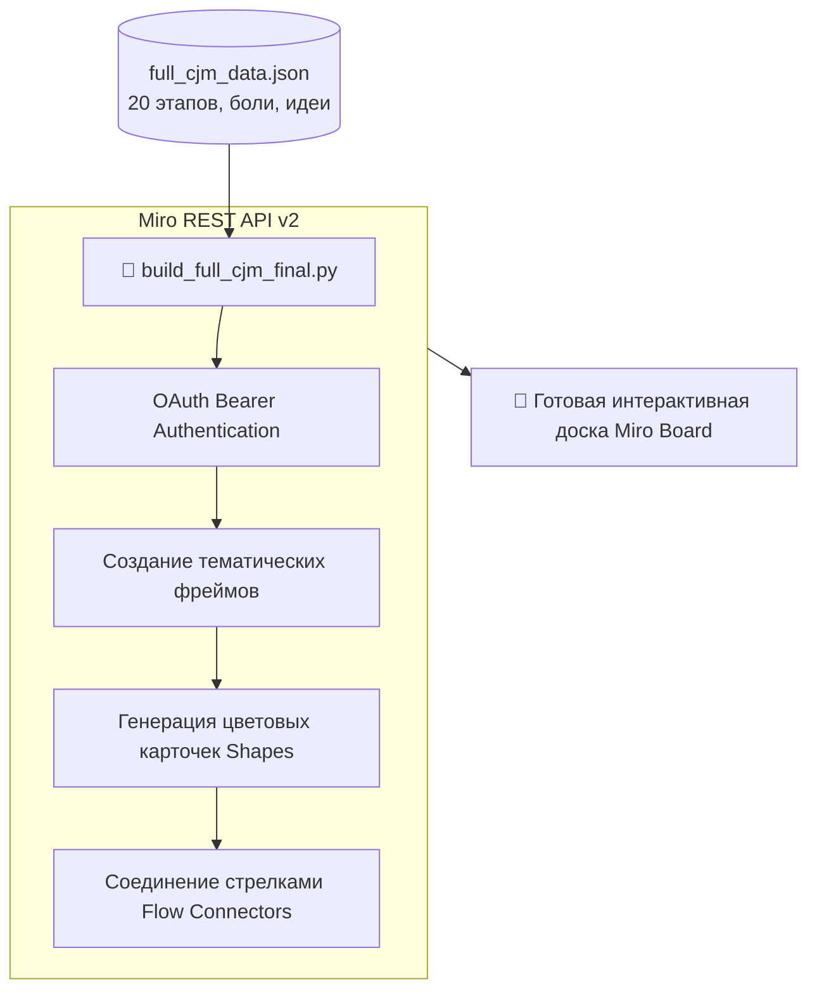

<div align="center">

# 🏦 Banking Process Modeling & Automated CJM via Miro API

**Комплексный кейс бизнес-анализа: программная генерация Customer Journey Map (CJM) на 20 этапов через Miro REST API v2, моделирование процессов AS-IS / TO-BE в нотации BPMN 2.0 под Draw.io и спецификации бизнес-требований (BRD).**

[](https://www.python.org/)
[](https://developers.miro.com/)
[](https://www.bpmn.org/)
[](https://app.diagrams.net/)
[](LICENSE)

[🇷🇺 Читать на русском](README.md) • [🇬🇧 Read in English](README.en.md)

---

</div>

## 📑 Содержание

1. [Бизнес-контекст и решаемая задача](#1-бизнес-контекст-и-решаемая-задача)
   * [1.1. Проблематика банковских каналов](#11-проблематика-банковских-каналов)
   * [1.2. Цели проекта](#12-цели-проекта)
2. [Ключевые артефакты бизнес-анализа](#2-ключевые-артефакты-бизнес-анализа)
   * [2.1. Автоматизированная сборка сквозного CJM в Miro](#21-автоматизированная-сборка-сквозного-cjm-в-miro)
   * [2.2. Процессы AS-IS и TO-BE в BPMN 2.0 (Банкоматы и Кассы)](#22-процессы-as-is-и-to-be-в-bpmn-20-банкоматы-и-кассы)
   * [2.3. Спецификации бизнес-требований (BRD)](#23-спецификации-бизнес-требований-brd)
3. [Архитектура программной интеграции с Miro API v2](#3-архитектура-программной-интеграции-с-miro-api-v2)
   * [3.1. Схема генератора доски](#31-схема-генератора-доски)
   * [3.2. Структура репозитория](#32-структура-репозитория)
4. [Стек технологий](#4-стек-технологий)
5. [Установка и запуск скрипта](#5-установка-и-запуск-скрипта)
6. [Автор и контакты](#6-автор-и-контакты)

---

## 1. Бизнес-контекст и решаемая задача

### 1.1. Проблематика банковских каналов
В омниканальном банковском обслуживании (физические отделения, кассы пересчета, банкоматы АТМ и мобильный банк) часто возникают разрывы клиентского опыта. Ручная отрисовка многоуровневых карт клиентского пути (CJM) и согласование требований между бизнесом и IT занимает недели.

### 1.2. Цели проекта
* **Оцифровать и автоматизировать:** Перевести данные исследований в структурированный JSON и программно через API собирать интерактивные доски в Miro;
* **Оптимизировать процессы:** Спроектировать сквозные модели «AS-IS» (текущее состояние с узкими местами) и целевые модели «TO-BE» в нотации BPMN 2.0;
* **Подготовить артефакты разработки:** Сформировать стандартизированные документы требований (BRD) для продуктовых IT-команд.

---

## 2. Ключевые артефакты бизнес-анализа

### 2.1. Автоматизированная сборка сквозного CJM в Miro
Скрипт `build_full_cjm_final.py` считывает файл `full_cjm_data.json` и автоматически генерирует на доске Miro до 20 этапов клиентского пути:
* **Этапы:** От пассивного внимания на улице до валютообменных операций в кассе, снятия наличных в АТМ и закрепления в мобильном приложении.
* **Слои информации на карточках:**
  1. *Touchpoint* (точка физического/цифрового контакта);
  2. *Цель клиента*;
  3. *Индекс эмоций и важности* (1–5);
  4. *Барьеры и боли (Pain Points)*;
  5. *Продуктовые гипотезы и решения (Feature Ideas)*.

### 2.2. Процессы AS-IS и TO-BE в BPMN 2.0 (Банкоматы и Кассы)

<div align="center">

| BPMN 2.0: Процесс в банкоматах AS-IS | BPMN 2.0: Оптимизированный процесс TO-BE |
|:---:|:---:|
|  |  |

| Алгоритм тарификации курсов валют (TO-BE RatesByRanges) | Модель расчета маржинальности (TO-BE PL by Markup) |
|:---:|:---:|
|  |  |

</div>

В папке `diagrams/` представлены как готовые визуальные схемы, так и векторные исходники в формате `.drawio`:
* `asis в банкоматах.drawio` vs `to be в банкоматах.drawio` — устранение лишних экранов подтверждения, оптимизация времени выдачи наличных.
* `asis в кассах.drawio` vs `to be в кассах.drawio` — интеграция электронной очереди и автоматизация валютного курса без участия оператора.

### 2.3. Спецификации бизнес-требований (BRD)
В папке `specs/` содержатся эталонные документы:
* `BRD-AFXRatesByRanges-Radius.md` — требования к миграции алгоритмов тарификации курсов валют в систему Radius.
* `01_шаблон_банкоматы.md`, `02_эталон_кассы.md` — функциональные и нефункциональные требования для разработки.

---

## 3. Архитектура программной интеграции с Miro API v2

### 3.1. Схема генератора доски



### 3.2. Структура репозитория

```text
07-alfabank-cjm-process-map/
├── build_full_cjm_final.py       # Python-клиент для генерации CJM через Miro API v2
├── full_cjm_data.json            # Полная структура 20 этапов клиентского пути
├── build_bpmn.py                 # Вспомогательный генератор BPMN-структур
├── diagrams/                     # Схемы процессов в формате Draw.io
│   ├── asis в банкоматах.drawio
│   ├── to be в банкоматах.drawio
│   ├── asis в кассах.drawio
│   └── to be в кассах.drawio
├── specs/                        # Бизнес-требования (BRD)
│   ├── BRD-AFXRatesByRanges-Radius.md
│   ├── 01_шаблон_банкоматы.md
│   └── 02_эталон_кассы.md
├── requirements.txt              # Зависимости Python
├── .env.example                  # Шаблон токенов Miro
├── .gitignore                    # Исключения Git
├── README.md                     # Документация на русском
└── README.en.md                  # English documentation
```

---

## 4. Стек технологий

* `Python 3.10+` & `Requests`
* `Miro REST API v2` (Shapes, Frames, Connectors)
* `BPMN 2.0` (Business Process Model and Notation)
* `Draw.io XML`
* `Business Requirements Document (BRD) Framework`

---

## 5. Установка и запуск скрипта

```bash
git clone https://github.com/Andrew123485/alfabank-cjm-process-map.git
cd alfabank-cjm-process-map

python -m venv venv
.\venv\Scripts\activate
pip install -r requirements.txt

# Настройка ключей Miro
cp .env.example .env
# Заполните MIRO_TOKEN и MIRO_BOARD_ID в .env

# Запуск генерации доски
python build_full_cjm_final.py
```

---

## 6. Автор и контакты

* **Автор:** Владимиров Андрей Георгиевич
* **Специализация:** Бизнес-аналитик / Продакт-менеджер (Финтех / КИБ)
* **Telegram:** [@amorfatimementomoria](https://t.me/amorfatimementomoria)
* **GitHub:** [github.com/Andrew123485](https://github.com/Andrew123485)
